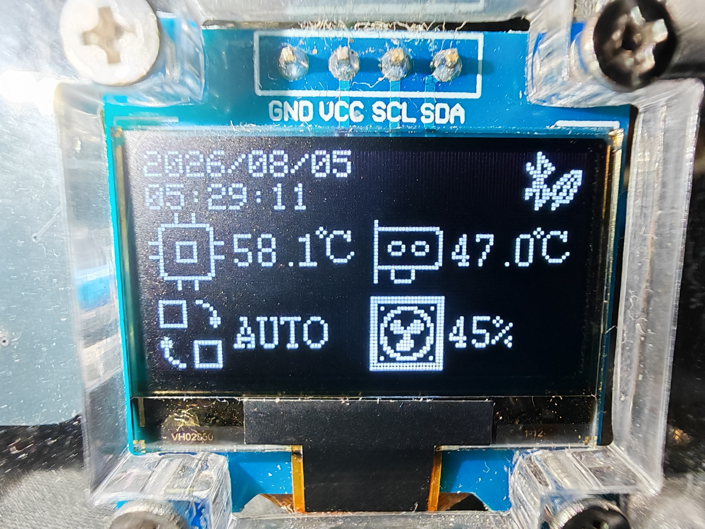
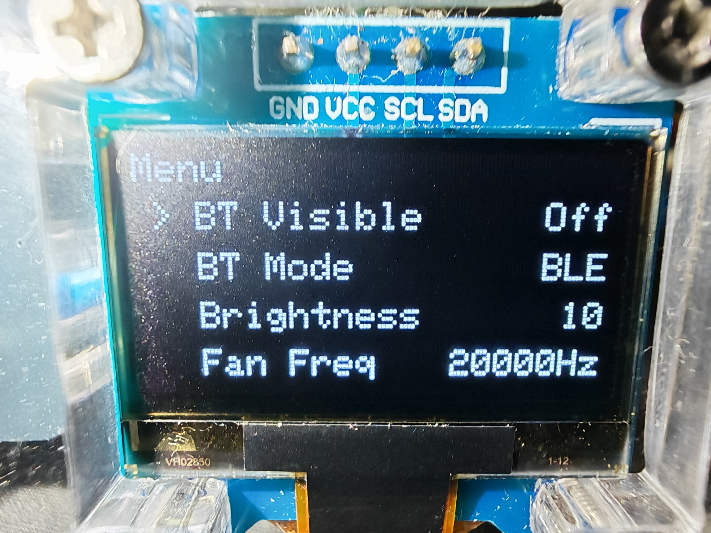
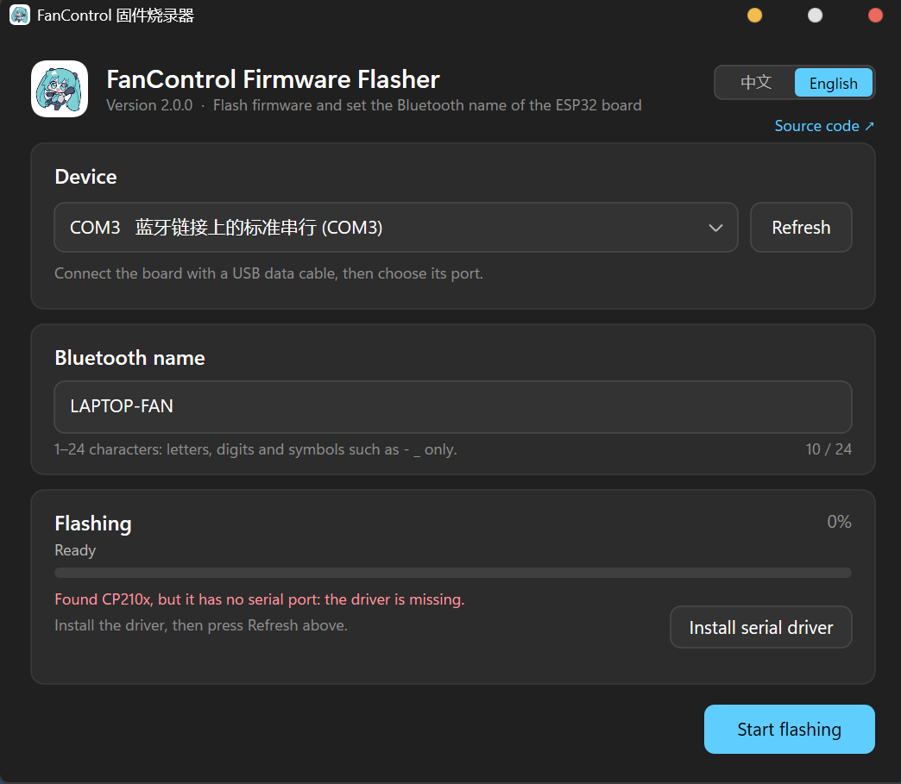

# ESP32-LaptopFan Firmware

[中文](README.md) | **English**

> Firmware for the open-source hardware by Bilibili creator [垃圾研究社](https://www.bilibili.com/video/BV1Lr421M7u2/). Works with the host software [anlerway/Bluetooth-FanControl](https://github.com/anlerway/Bluetooth-FanControl) to form a complete laptop fan control solution.

  

## Repository Layout

| Path | Contents |
| --- | --- |
| `LAPTOP_FAN/` | Firmware source (Arduino sketch; open `LAPTOP_FAN.ino` in Arduino IDE) |
| `flasher/` | Companion Windows flasher: no Arduino IDE needed, custom Bluetooth name, bundled USB-serial drivers |
| `images/` | Photos used by the docs |

## Physical Photos

## Features

- **Redesigned OLED main interface**: status bar (date/time + Bluetooth status) + 2×2 four-icon dashboard;
- **Time display**: supports the `TIME` command from the host for time synchronisation;
- **Dual communication**: Classic Bluetooth SPP (COM mode) / BLE (Nordic UART service);
- **Hidden Bluetooth**: visibility can be toggled to stop others from connecting at will;
- **Custom Bluetooth name**: `BT_DEVICE_NAME` in `config.h` can be overridden at compile time, so the flasher renames the device without editing the source;
- **Button interaction**: menu / auto / manual / speed ±, long-press for sleep;
- Receives PWM / temperature / time-sync commands from the host and answers `STATUS?` queries.

## Flashing Guide

### Method 1: Use the bundled flasher (recommended)

No Arduino IDE, no toolchain. Plug in the cable, click once, and rename the device along the way.

1. Download the `FanControl-Flasher` release (see [Releases](<https://github.com/anlerway/ESP32-LaptopFan/releases>)),
   extract it and run `FanControl-Flasher.exe` (it needs administrator rights, so expect one UAC prompt);
2. Connect the board to the PC with a USB data cable, press **Refresh** in the UI and pick it from the port list;
3. Type a **Bluetooth name** if you want to rename the device, or leave it as is;
4. Hold the board's **BOOT** button and press **Start flashing**, then wait for the progress bar to finish.

If the UI reports "detected xxx but no serial port: driver missing", just press **Install serial driver** —
signed vendor drivers for CH340/CH341, CH343/CH9102, CP210x, FTDI and PL2303 are bundled.

Flasher source, implementation details (placeholder-name patching + image integrity recomputation) and
build instructions: [flasher/README.en.md](flasher/README.en.md).

### Method 2: Flash Download Tool (Espressif)

1. Download the compiled release from [GitHub Releases](<https://github.com/anlerway/ESP32-LaptopFan/releases>) and extract it.
2. Download the official Espressif flashing tool [Flash Download Tool](https://docs.espressif.com/projects/esp-test-tools/zh_CN/latest/esp32/production_stage/tools/flash_download_tool.html).
3. Connect the ESP32 board to the PC over USB and make sure a serial port shows up in Device Manager.
4. Open the tool, select chip model **ESP32**, load the extracted `.bin` files, configure the flashing parameters and press start.

| Flash address | Firmware file |
| --- | --- |
| 0x1000 | LAPTOP_FAN.ino.bootloader.bin |
| 0x8000 | LAPTOP_FAN.ino.partitions.bin |
| 0x10000 | LAPTOP_FAN.ino.bin |

### Method 3: Build and flash from source (Arduino IDE)

1. Get the source: `git clone https://github.com/anlerway/ESP32-LaptopFan`.
2. Install **Arduino IDE 2.3.10**.
3. Install the ESP32 board package: search for `esp32 by Espressif` (version **2.0.4**) in the Boards Manager and install it.
4. Install the libraries: `Adafruit SSD1306`, `Adafruit GFX`.
5. Open `LAPTOP_FAN/LAPTOP_FAN.ino` in Arduino IDE.
6. Board settings: select **ESP32 Dev Module** (4MB Flash, default partition scheme) and the matching serial port.
7. Press Upload to compile and flash.

## Hardware Button Logic

The device has **5 buttons** (left to right) and two modes: home and menu.

### Home mode (default)

| Button | Function |
| --- | --- |
| Button 1 | Speed down (long-press for continuous adjustment) |
| Button 2 | Speed up (long-press for continuous adjustment) |
| Button 3 | Switch to **manual mode** |
| Button 4 | Switch to **auto mode** |
| Button 5 | Long-press 3 seconds to enter **sleep**; press again to **wake up** |

### Menu mode

Long-press Button 5 to enter menu mode:

| Button | Function |
| --- | --- |
| Button 1 | Value down (long-press for continuous adjustment) |
| Button 2 | Value up (long-press for continuous adjustment) |
| Button 3 | Select up |
| Button 4 | Select down |
| Button 5 | Exit the menu and return home |

## Menu Options

| Menu item | Description |
| --- | --- |
| **BT Visible** (Bluetooth visibility) | After pairing, turning on **hidden** mode is recommended to stop other people from pairing; existing connections and auto-reconnect keep working |
| **BT Mode** (connection mode) | **BLE** is recommended: lower power and no need to pick a serial port manually |
| **Brightness** (screen brightness) | Adjusts the OLED brightness |
| **Fan Freq** (PWM frequency) | Leave it at the default; if the fan does not spin, try adjusting this value |

## Hardware Pinout (config.h)

| Definition | Pin | Function |
| --- | --- | --- |
| `PIN_FAN` | 5 | Fan PWM (LEDC, 15 kHz by default) |
| `PIN_RELAY` | 19 | Relay |
| `PIN_BTN1` ~ `PIN_BTN5` | 12 / 13 / 14 / 15 / 16 | Menu / auto / manual / speed+ / speed- |
| OLED | I2C address `0x3C` | SSD1306 128×64 |

## Communication Protocol

One-line ASCII text frames terminated by `\r\n`:

- Host → firmware: `PWM:<0-100>`, `TIME:yyyy/MM/dd HH:mm:ss`, `TEMP:<cpu>[,<gpu>]`;
- Firmware → host: `READY` (connection handshake), `STATUS:...` (query response).

BLE uses the Nordic UART service (`6e400001-...`, write `6e400002`, notify `6e400003`).

## Host Software Integration

- **BLE mode**: device name defaults to `LAPTOP-FAN` (rename it with the flasher); the host software searches and connects;
- **COM mode**: connect over the USB serial port or a classic Bluetooth SPP virtual COM port (115200 baud by default); the device name is `<name>-COM`;
- The host software's settings page can switch Bluetooth modes, and time synchronisation happens automatically.

## Disclaimer

Flashing software requires administrator rights and may be flagged by antivirus software; add it to your
whitelist if that happens.
