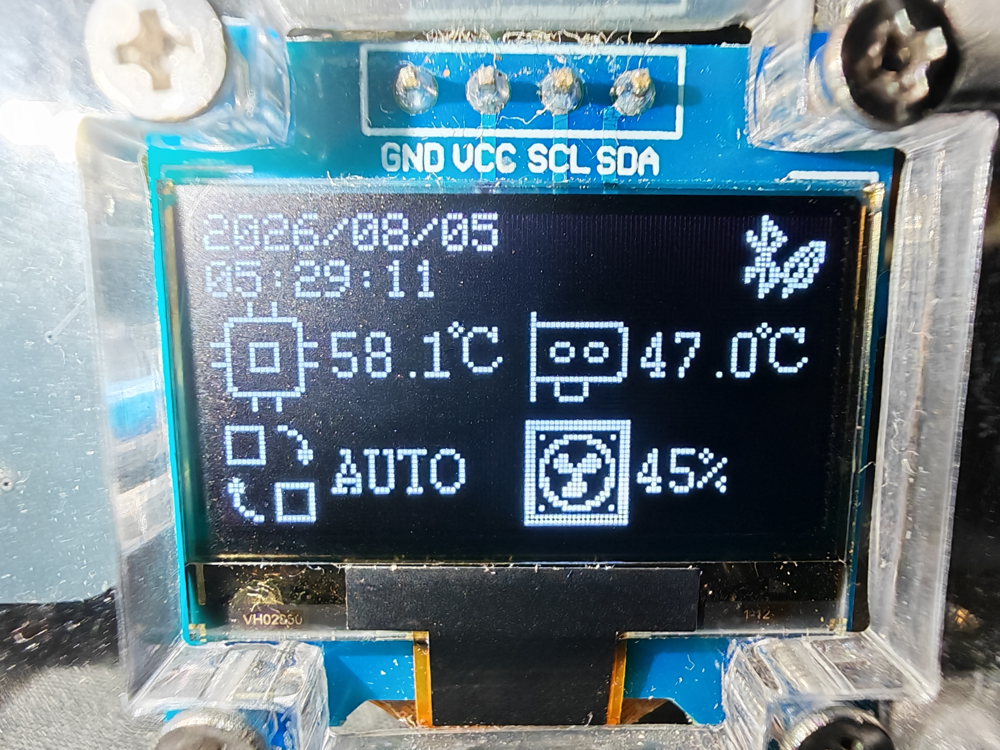
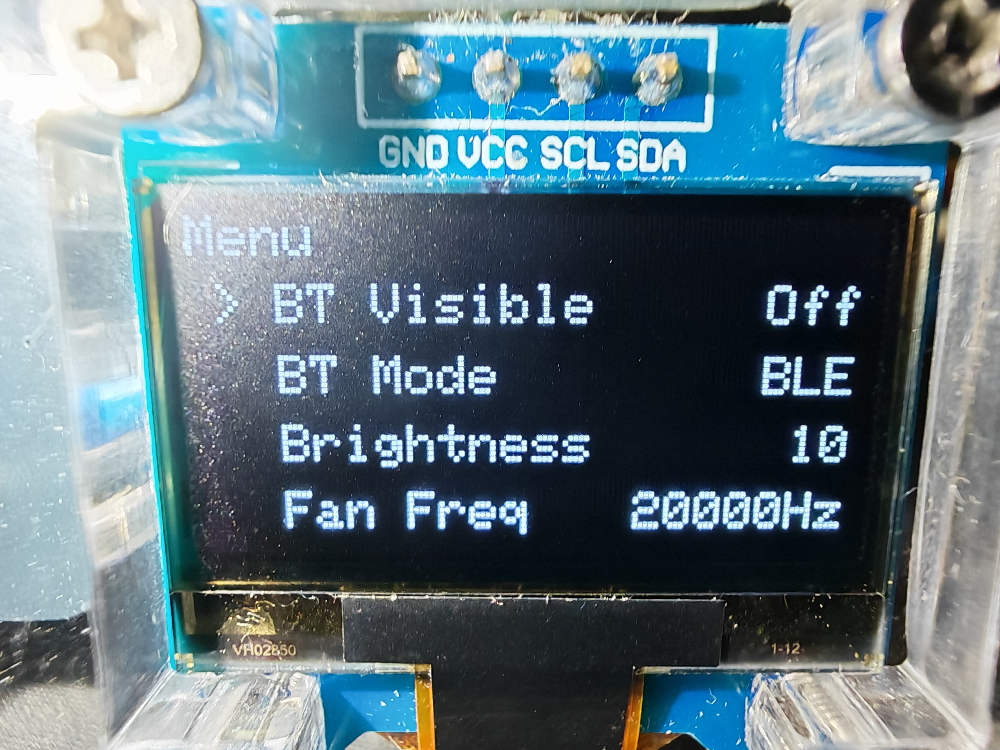

# ESP32-LaptopFan 固件

[English](README.en.md) | **中文**

> 适配 UP 主[垃圾研究社](https://www.bilibili.com/video/BV1Lr421M7u2/)开源硬件的固件，配合上位机 [anlerways/Bluetooth-FanControl](https://github.com/anlerway/Bluetooth-FanControl) 使用，组成完整的笔记本风扇控制方案。

 

## 实物图





## 功能

- **重制 OLED 主界面**：状态栏（日期时间 + 蓝牙状态）+ 2×2 四宫格图标控制台；
- **时间显示**：支持上位机 `TIME` 指令校时；
- **双通信**： 经典蓝牙 SPP（COM 模式）/ BLE（Nordic UART 服务）；
- **隐藏蓝牙**：可切换隐藏/可见，防止蓝牙被他人乱连；
- **按键交互**：菜单 / 自动 / 手动 / 转速 ±，长按设置休眠；
- 接收上位机 PWM / 温度 / 校时指令，响应 `STATUS?` 查询。

## 硬件接线（config.h）

| 定义 | 引脚 | 功能 |
| --- | --- | --- |
| `PIN_FAN` | 5 | 风扇 PWM（LEDC，默认 15kHz） |
| `PIN_RELAY` | 19 | 继电器 |
| `PIN_BTN1` ~ `PIN_BTN5` | 12 / 13 / 14 / 15 / 16 | 菜单 / 自动 / 手动 / 转速+ / 转速- |
| OLED | I2C 地址 `0x3C` | SSD1306 128×64 |

## 环境配置

- Arduino IDE 2.3.10；
- ESP32 板包：`esp32 by Espressif`（2.0.4）；
- 依赖库：`Adafruit SSD1306`、`Adafruit GFX`；
- 开发板设置：`ESP32 Dev Module`（4MB Flash，默认分区）。

## 编译烧录

固件源码下载：[anlerways/ESP32-LaptopFan](https://github.com/anlerway/ESP32-LaptopFan)

1. 用 Arduino IDE 打开 `LAPTOP_FAN.ino`；
2. 工具 → 开发板选择 `ESP32 Dev Module`，端口选择对应串口；
3. 点击上传（烧录）即可。

也可以直接烧录编译产物（`build/esp32.esp32.esp32/`）：

编译产物下载：GitHub Releases（<https://github.com/anlerway/ESP32-LaptopFan/releases>）

```
esptool.py --chip esp32 --port COMx write_flash \
  0x1000  LAPTOP_FAN.ino.bootloader.bin \
  0x8000  LAPTOP_FAN.ino.partitions.bin \
  0x10000 LAPTOP_FAN.ino.bin
```

## 通信协议

一行 ASCII 文本帧，`\r\n` 结尾：

- 上位机 → 固件：`PWM:<0-100>`、`TIME:yyyy/MM/dd HH:mm:ss`、`TEMP:<cpu>[,<gpu>]`；
- 固件 → 上位机：`READY`（连接握手）、`STATUS:...`（查询应答）。

## 上位机联动

- **BLE 模式**：设备名 `LAPTOP-FAN`，上位机搜索并连接；
- **COM 模式**：使用 USB 串口或经典蓝牙 SPP 虚拟串口连接（默认波特率 115200）；
- 上位机设置页可切换蓝牙模式、固件校时自动进行。

## 免责声明

风扇控制涉及硬件散热，请谨慎调节转速曲线；固件按现状提供，使用风险自负。
