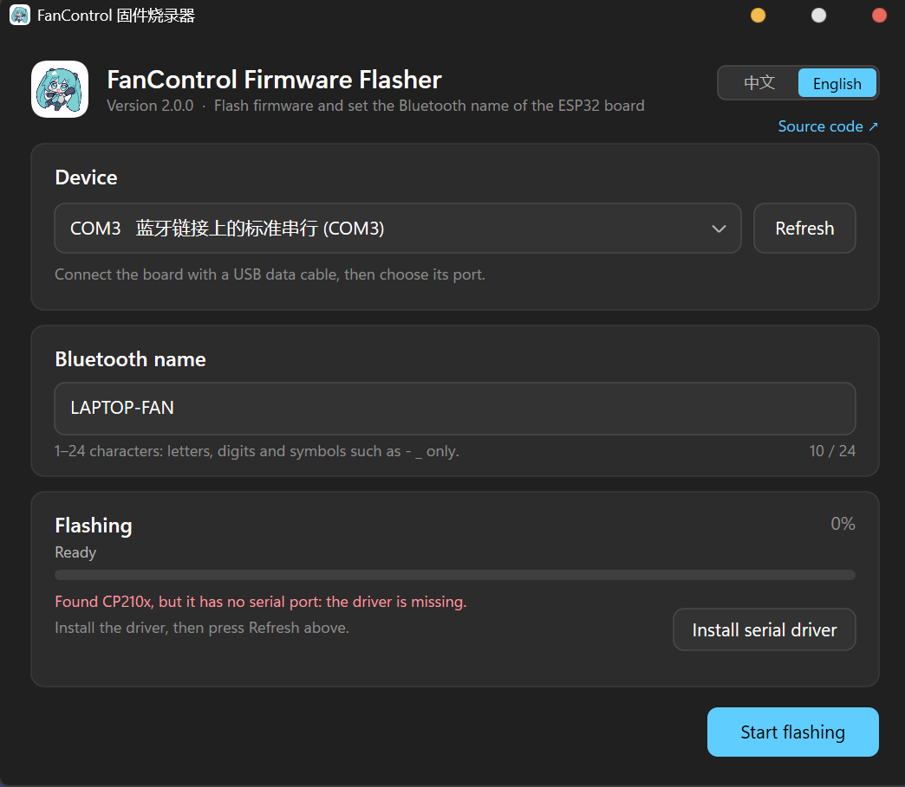
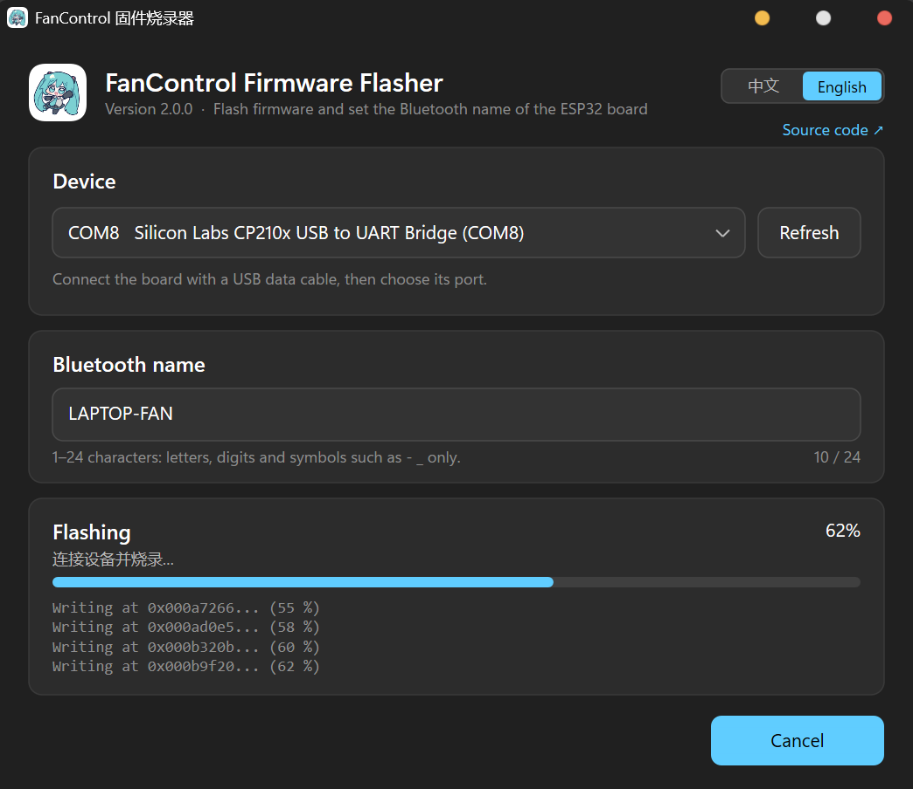

# FanControl Firmware Flasher

A small Windows tool that writes firmware to an [ESP32-LaptopFan](https://github.com/Anlerway/ESP32-LaptopFan)
board: pick a serial port, type a Bluetooth name, press one button. No Arduino IDE, no Python,
no firmware rebuild required.

Written in plain Win32 + Direct2D. The executable is under 400 KB and needs neither .NET nor Python.
Chinese and English UI included.

## UI

**Main window**



**Flashing: step text and progress bar on the left, the source link in the top-right corner, live esptool log below**



## Features

- **One-click flashing** — bundles bootloader / partitions / app images and writes them at
  0x1000 / 0x8000 / 0x10000.
- **Custom Bluetooth name** — type the name; the companion serial-port name becomes `<name>-COM`.
  No source edits, no recompiling.
- **Port picker + refresh** — plug the board in, hit Refresh, pick the new port.
- **Bundled USB-serial drivers** — CH340/CH341, CH342/CH343/CH9102, CP210x, FTDI, PL2303.
  When a device is present but has no COM port, the UI names the chip and offers an
  "Install serial driver" button (runs `pnputil`).
- **Bilingual UI** — the 中文 / English switch in the top-right corner is remembered in the registry.
- **Runs elevated by default** — the manifest declares `requireAdministrator`, so driver
  installation needs no second UAC prompt.
- **Visible failures** — esptool output is shown in a message box on error; the temp directory is
  chosen from three candidates (%TEMP% → %LOCALAPPDATA%\Temp → the exe folder) and verified writable.

## Release layout

```
FanControl-Flasher.exe    main program
tools\esptool.exe         the official Espressif flasher (GPLv2), called as an external process
firmware\                 bootloader.bin / partitions.bin / app.bin
drivers\                  vendor USB-serial drivers, one folder per chip
使用说明.txt               end-user notes (Chinese)
```

Copy the whole folder — the program locates `tools\`, `firmware\` and `drivers\` relative to itself.

## Source layout

```
src\main.cpp       window, `--install-driver` branch
src\app.cpp        all UI and interaction (painting, hit testing, text field, flash thread)
src\app.h          layout constants and HitId enum
src\firmware.cpp   image loading, Bluetooth rename, integrity fix
src\espclt.cpp     runs esptool, parses progress and log output
src\drivers.cpp    port / VID-PID enumeration, pnputil driver install
src\i18n.cpp       string tables and language persistence
src\ui.cpp         Direct2D drawing primitives
src\theme.cpp      colours and fonts
assets\            the three release images + icon
drivers\           driver files per chip, origins in drivers/SOURCES.md
docs\              screenshots used by this README
tools\             packaging script, firmware rebuild script, end-user notes template
```

## How the rename works

1. Shipped firmware is compiled with a **fixed 24-character placeholder name**:
   `arduino-cli compile --fqbn esp32:esp32:esp32 --build-property "compiler.cpp.extra_flags=-DBT_DEVICE_NAME=\"FAN-NAME-PLACEHOLDER-XXX\""`
   (see `BT_DEVICE_NAME` / `BT_DEVICE_NAME_COM` in `LAPTOP_FAN/config.h`).
2. The placeholder appears twice in app.bin — at offset 522 (24 bytes) and 547 (`-COM`, 28 bytes).
   The flasher finds both slots and overwrites them **in place**, zero-padding short names.
3. The image integrity data must be recomputed afterwards or the ESP32 bootloader rejects it:
   `[E9 header][segment table + data][pad to 16][1-byte XOR checksum, seed 0xEF][32-byte SHA-256]`.
   `FixImageIntegrity` in `firmware.cpp` recomputes both with CNG BCrypt.

Limits: names are at most 24 UTF-8 bytes and cannot contain NUL. Only the Bluetooth name changes —
the COM/BLE mode and visibility are still set with the device buttons and stored in NVS.

## Building from source

Requires the Visual Studio 2022/2026 C++ toolchain (`cl.exe`):

```bat
build.bat 2.0.0                                          :: produces build\FanControl-Flasher.exe
powershell -File tools\make-package.ps1 -Version 2.0.0   :: assembles out\FanControl-Flasher-2.0.0\
```

- `build.bat` locates vcvars64 itself (including `D:\APP\Visual Studio2026`), generates
  `build\version.h` and compiles the nine .cpp files.
- `tools\make-package.ps1` copies the exe, `tools\esptool.exe`, `assets\*.bin`, `drivers\` and the
  end-user notes into `out\`. The script must be saved as **UTF-8 with BOM**.
- Rebuilding firmware: `tools\build-firmware.bat` compiles with the placeholder name via arduino-cli
  and refreshes `assets\*.bin`.

**About `tools\esptool.exe`**: the 7.6 MB official tool is not stored in this repository
(`.gitignore` excludes it). Copy it from the Arduino esp32 package when you need it:

```
%LOCALAPPDATA%\Arduino15\packages\esp32\tools\esptool_py\<version>\esptool.exe
```

`make-package.ps1` looks there automatically and fails loudly if it cannot find a copy.

## Third party

- `tools\esptool.exe` — Espressif esptool 3.3.0-cn, GPLv2, invoked unmodified as an external process.
- Drivers under `drivers\` are unmodified vendor packages, all WHQL-signed by Microsoft:

| Folder | INF | Version | Covers |
|---|---|---|---|
| ch34x | CH341SER.INF | 3.9.2024.09 | CH340 / CH340K / CH341 |
| ch9102 | CH343SER.INF | 2.2.2026.05 | CH342 / CH343 / CH9101 / CH9102 |
| cp210x | silabser.inf | 11.2.0.167 | CP2102 / CP2105 / CP2108 |
| ftdi | ftdibus.inf + ftdiport.inf | 2.12.36.20 | FT232R / FT2232 / FT231X and friends |
| pl2303 | ser2pl.inf + plser.inf | 3.8.38.2 / 5.1.11.0 | PL2303 family (both INFs required) |

Drivers are only installed when you press "Install serial driver", via
`pnputil /add-driver ... /install`; they can be removed again from Device Manager.
Per-folder provenance (URL, checks) is in [drivers/SOURCES.md](drivers/SOURCES.md).

## Versions

- **2.0.0** — added the "Source code" link (opens the repository in a browser), minor UI polish.
- 1.0.4 — added ch9102 / ftdi / pl2303 drivers; VID/PID table switched to range matching
  (fixes CH340K being pointed at the wrong driver).
- 1.0.3 — Chinese/English UI switch (persisted), runs elevated by default.
- 1.0.2 — drivers / esptool / firmware moved into their own folders; exe shrank from 1.5 MB to 390 KB.
- 1.0.1 — fixed "failed to write temporary firmware"; three-level temp fallback and write retries.

## License

See LICENSE in the parent directory. esptool and the vendor drivers keep their own licenses.
