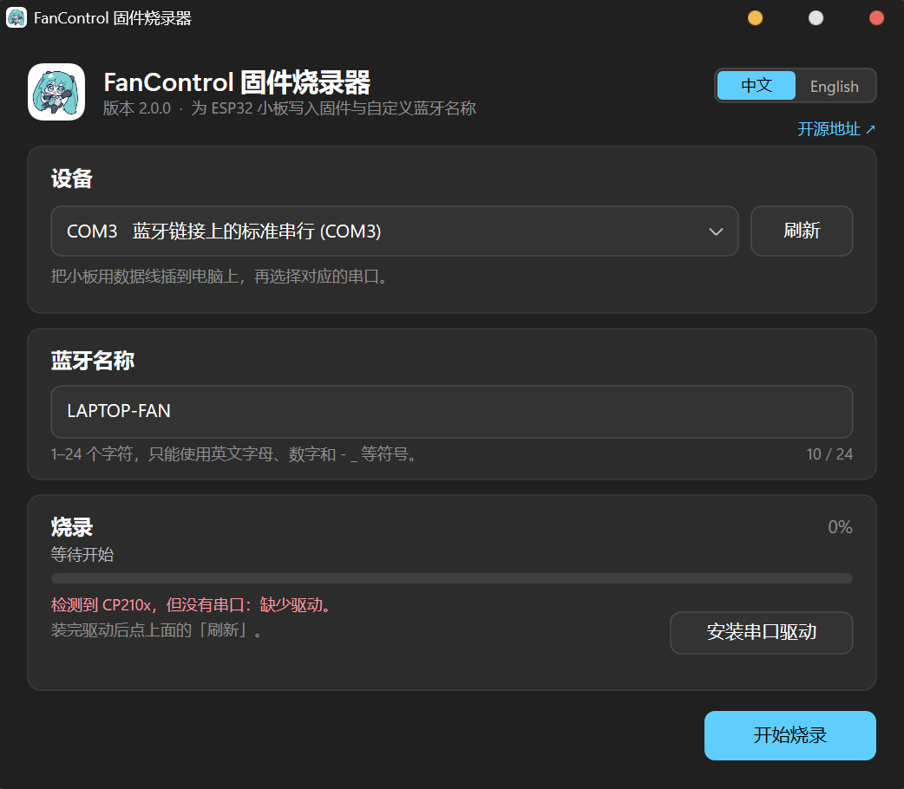
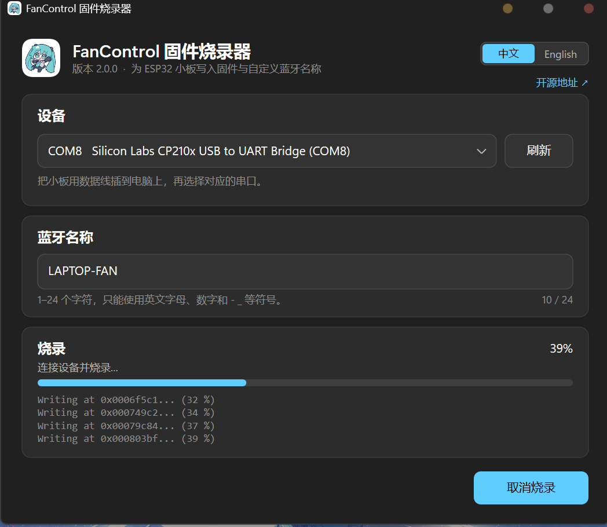

# FanControl 固件烧录器

给 [ESP32-LaptopFan](https://github.com/Anlerway/ESP32-LaptopFan) 小板写固件的 Windows 小工具：
选串口、填一个蓝牙名、点一下，固件和名字一起写进去。不需要装 Arduino IDE，不需要装 Python，
也不需要重新编译固件。

纯 Win32 + Direct2D 写的，单个 exe 不到 400 KB，不依赖 .NET / Python；带中英界面切换。

## 界面

**主界面**



**烧录中：左侧步骤与进度条，右上角是「开源地址」链接，下方是 esptool 实时日志**



## 功能

- **一键烧录**：内嵌 bootloader / partitions / app 三个镜像，按 0x1000 / 0x8000 / 0x10000 写入。
- **自定义蓝牙名**：填名字即可，配套的串口名自动是 `<名字>-COM`；不用改源码、不用重编。
- **拖动串口选择 + 刷新**：插上板子点刷新就能看到新串口。
- **内置串口驱动**：CH340/CH341、CH342/CH343/CH9102、CP210x、FTDI、PL2303 全系列，
  检测到"有设备但没串口"时界面直接提示芯片型号并给一个「安装串口驱动」按钮（走 pnputil）。
- **中英界面**：右上角「中文 / English」切换，选择写进注册表，下次沿用。
- **默认管理员权限**：manifest 里 `requireAdministrator`，双击弹一次 UAC，装驱动不用再提权。
- **失败可见**：esptool 报错弹对话框给全文；临时目录会自动挑三个候选位置（%TEMP% →
  %LOCALAPPDATA%\Temp → exe 目录）并写探针验证。

## 发布包结构

```
FanControl-Flasher.exe    主程序
tools\esptool.exe         真正干活的官方烧录工具（Espressif，GPLv2）
firmware\                 bootloader.bin / partitions.bin / app.bin
drivers\                  串口芯片驱动（按芯片分目录，各带厂商 INF/CAT/SYS）
使用说明.txt               给最终用户看的说明
```

整个文件夹要一起拷，程序靠相对路径找 `tools\`、`firmware\`、`drivers\`。

## 源码结构

```
src\main.cpp       窗口、`--install-driver` 分支
src\app.cpp        全部界面与交互（绘制、命中测试、输入框、烧录线程调度）
src\app.h          布局常量与 HitId 枚举
src\firmware.cpp   读镜像、改蓝牙名、修镜像完整性
src\espclt.cpp     起 esptool 子进程、解析进度与日志
src\drivers.cpp    枚举串口与 VID/PID、调 pnputil 装驱动
src\i18n.cpp       中英文案表与语言记忆
src\ui.cpp          Direct2D 绘制原语
src\theme.cpp       配色与字体
assets\            发布用的三个镜像 + 图标
drivers\           驱动文件（按芯片分目录，来源见 drivers/SOURCES.md）
docs\              README 用的截图
tools\             打包脚本、固件重编脚本、使用说明模板
```

## 怎么做到"改个名字就行"

1. 发布用的固件是用**固定 24 字符的占位名**编译的：
   `arduino-cli compile --fqbn esp32:esp32:esp32 --build-property "compiler.cpp.extra_flags=-DBT_DEVICE_NAME=\"FAN-NAME-PLACEHOLDER-XXX\""`
   （源码侧 `LAPTOP_FAN/config.h` 的 `BT_DEVICE_NAME` / `BT_DEVICE_NAME_COM` 两个宏）。
2. 占位串在 app.bin 里出现两次：偏移 522（24 字节）与 547（`-COM`，28 字节）。
   烧录时在镜像里搜这两个槽，**等长覆盖**，短名补 `\0`。
3. 改完必须重算镜像完整性，否则 ESP32 启动器判定镜像损坏：镜像尾部结构是
   `[E9 头][段表+段数据][补齐到 16][1 字节 XOR 校验(初值 0xEF)][32 字节 SHA-256]`，
   `firmware.cpp` 的 `FixImageIntegrity` 用 CNG BCrypt 重算校验字节和哈希。

限制：名字 ≤ 24 字节 UTF-8（中文一个字 3 字节），不能含 NUL。只改蓝牙名，
蓝牙模式（COM/BLE）和可见性仍在设备菜单里用按键设置，存在 NVS 里。

## 从源码构建

需要 Visual Studio 2022/2026 的 C++ 工具链（`cl.exe`）：

```bat
build.bat 2.0.0                                            :: 产物 build\FanControl-Flasher.exe
powershell -File tools\make-package.ps1 -Version 2.0.0     :: 组装 out\FanControl-Flasher-2.0.0\
```

- `build.bat` 自己找 vcvars64（含 `D:\APP\Visual Studio2026`），生成 `build\version.h` 后编译 9 个 cpp。
- `tools\make-package.ps1` 拷 exe、`tools\esptool.exe`、`assets\*.bin`、`drivers\`、使用说明到 out。
  脚本本身必须存成 **UTF-8 BOM**，否则 PowerShell 5.1 按 ANSI 读中文会报参数为空。
- 换固件：`tools\build-firmware.bat` 用 arduino-cli 按占位名重编，覆盖 `assets\*.bin`。

**关于 `tools\esptool.exe`**：7.6 MB 的官方工具，仓库里不放（`.gitignore` 已忽略），
需要时从 Arduino 的 esp32 板包复制一份即可：

```
%LOCALAPPDATA%\Arduino15\packages\esp32\tools\esptool_py\<版本>\esptool.exe
```

`make-package.ps1` 会自动去这个路径找；找不到就直接报错退出。

## 第三方

- `tools\esptool.exe`：Espressif esptool 3.3.0-cn，GPLv2，仅作外部进程调用，未修改。
- `drivers\` 下驱动为各厂商原版文件，全部微软 WHQL 签名：

| 目录 | INF | 版本 | 覆盖 |
|---|---|---|---|
| ch34x | CH341SER.INF | 3.9.2024.09 | CH340 / CH340K / CH341 |
| ch9102 | CH343SER.INF | 2.2.2026.05 | CH342 / CH343 / CH9101 / CH9102 |
| cp210x | silabser.inf | 11.2.0.167 | CP2102 / CP2105 / CP2108 |
| ftdi | ftdibus.inf + ftdiport.inf | 2.12.36.20 | FT232R / FT2232 / FT231X 等 |
| pl2303 | ser2pl.inf + plser.inf | 3.8.38.2 / 5.1.11.0 | PL2303 全系列（两个 INF 缺一不可） |

驱动只在你点「安装串口驱动」时通过 `pnputil /add-driver ... /install` 装进系统驱动库，
装完可以在设备管理器里卸载并删除。每个目录的具体来源（URL、校验）见 [drivers/SOURCES.md](drivers/SOURCES.md)。

## 版本

- **2.0.0**：加「开源地址」跳转（点开浏览器到仓库），界面小调整。
- 1.0.4：补 ch9102 / ftdi / pl2303 驱动，VID/PID 表改成区间匹配（修 CH340K 归错驱动的问题）。
- 1.0.3：中英界面切换（记进注册表）、默认管理员权限运行。
- 1.0.2：驱动 / esptool / 固件外置到独立文件夹，exe 从 1.5 MB 降到 390 KB。
- 1.0.1：修「写入临时固件失败」，临时目录三级兜底 + 写盘重试。

## 许可

本仓库代码见上级目录的 LICENSE。esptool 与各厂商驱动遵循其各自许可。
